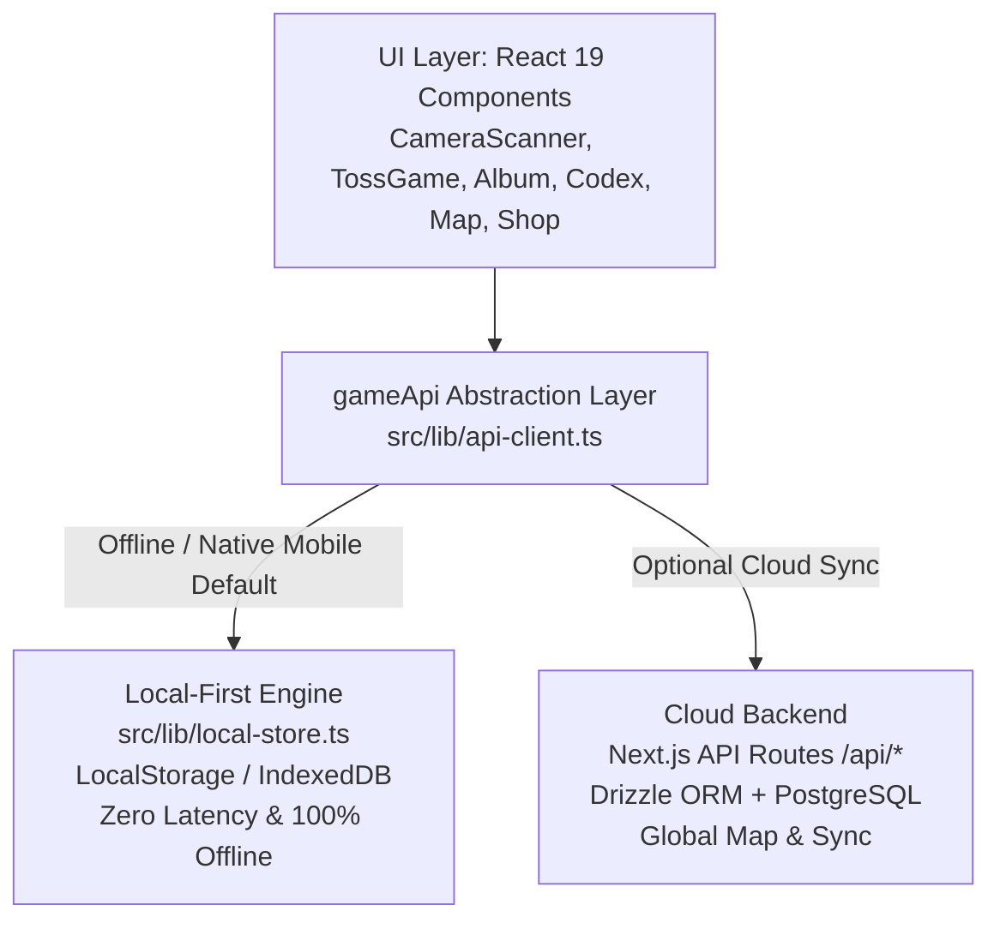
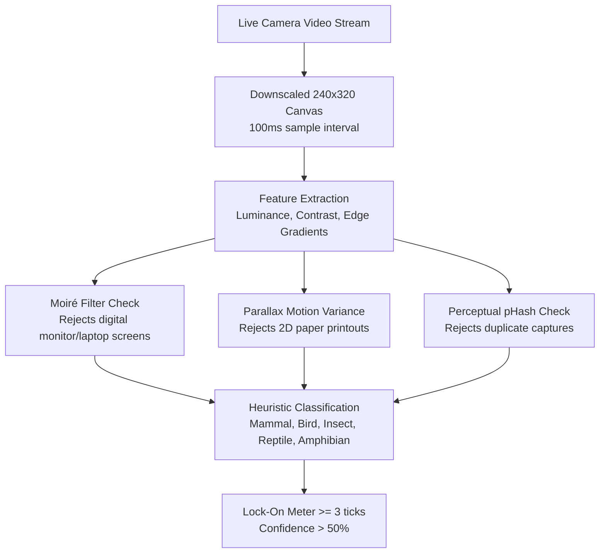

# 🐾 AnimaFind — Comprehensive Technical & Gameplay Documentation

Welcome to the definitive documentation for **AnimaFind** (Critter Codex), an augmented-reality, real-world wildlife exploration, card-collecting, and field journal game built for modern Web, iOS (iPhones), and Android.

---

## 📋 Table of Contents
1. [Executive Summary](#1-executive-summary)
2. [Technology Stack](#2-technology-stack)
3. [Architecture Overview: Dual-Engine Design](#3-architecture-overview-dual-engine-design)
4. [Mobile Architecture: iOS & Android via Capacitor](#4-mobile-architecture-ios--android-via-capacitor)
5. [Step-by-Step Mobile Development & Publishing Guide](#5-step-by-step-mobile-development--publishing-guide)
6. [Computer Vision & Anti-Cheat Heuristics Pipeline](#6-computer-vision--anti-cheat-heuristics-pipeline)
7. [Core Gameplay Loops & Mechanics](#7-core-gameplay-loops--mechanics)
8. [Procedural Card Generation & Rarity Engine](#8-procedural-card-generation--rarity-engine)
9. [Economy, Energy & Monetization System](#9-economy-energy--monetization-system)
10. [Ethics, Privacy & Sensitive Species Protection](#10-ethics-privacy--sensitive-species-protection)
11. [Project Directory & File Structure](#11-project-directory--file-structure)
12. [API & Data Storage Reference](#12-api--data-storage-reference)
13. [Troubleshooting & Frequently Asked Questions](#13-troubleshooting--frequently-asked-questions)

---

## 1. Executive Summary

**AnimaFind** gamifies outdoor exploration, biodiversity appreciation, and field biology with collectible card mechanics:

1. **Find Real Wildlife:** Players discover living animals (birds, mammals, insects, reptiles, amphibians) outdoors in nature.
2. **On-Device Real-Time Lock-On:** The device camera processes frames via client-side computer vision heuristics that verify biological features while filtering out spoof attempts (digital screens, printed photos).
3. **The Tin-Can Toss:** Players expend 1 Can (energy) to play an intuitive physics flick-and-toss minigame to safely 'tag' the creature into their field journal.
4. **Procedural Minting:** Once landed, the encounter generates a unique digital trading card with randomized stats, abilities, rarity tier (Hedgerow to Aurora Legendary), serial numbers, and holographic animations.
5. **Field Journal & Community:** Players track their sightings in the **Album**, research biodiversity in the **Encyclopedia**, find localized hotspots on the **Community Map** (with fuzzed GPS to prevent poaching), compare collections with **Friends**, and vote on future **PvP duel** features.

---

## 2. Technology Stack

| Layer | Technologies Used | Description |
|---|---|---|
| **Frontend Framework** | **Next.js 16 (Turbopack) & React 19** | Modern App Router, Server and Client Components, fast incremental rendering. |
| **Styling & Design System** | **TailwindCSS v4** | Hand-crafted Field Journal aesthetic with doodle borders, tape accents, and paper textures. |
| **Mobile Runtime** | **Capacitor 8 (@capacitor/core, @capacitor/ios, @capacitor/android)** | Cross-platform native bridge wrapping the web app inside native iOS WKWebView and Android WebView. |
| **Client Vision Engine** | **HTML5 Canvas, WebRTC MediaStream, 64-bit pHash** | Pure JavaScript real-time luminance feature extraction, moiré pattern detection, and perceptual hashing. |
| **Audio Engine** | **Web Audio API (Synthesized oscillators)** | Zero-asset-dependency dynamic audio effects (click, card reveal, lock chime, coin sounds). |
| **Local Storage (Offline Engine)** | **LocalStorage / IndexedDB (localStore)** | 100% on-device game engine allowing complete offline play on phones without servers or databases. |
| **Backend & Cloud Database (Optional)** | **Drizzle ORM & PostgreSQL** | Scalable relational backend with schema migrations, GDPR consent tracking, and community sync. |

---

## 3. Architecture Overview: Dual-Engine Design

AnimaFind is engineered with a hybrid architecture supporting two complementary modes:



1. **Local-First Mode (Native Mobile & Offline)**:
   - Powered by `src/lib/local-store.ts`.
   - Requires no backend server, database, or internet connection.
   - Ideal for hikers in remote parks with poor reception.
2. **Cloud Mode (Multiplayer & Shared World)**:
   - Powered by `src/app/api/**` and Drizzle ORM (`src/db/schema.ts`).
   - Syncs sightings, trades, and global leaderboards.

---

## 4. Mobile Architecture: iOS & Android via Capacitor

Capacitor bridges the web app into native wrappers for Apple and Google platforms.

### Native Identifiers:
- **App Identifier:** `com.animafind.app`
- **Product Name:** `AnimaFind`
- **Configuration:** `capacitor.config.ts`

### iOS Configuration (`ios/App/App/Info.plist`):
Apple enforces strict privacy declarations. The following keys are configured:
- `NSCameraUsageDescription`: Explains camera access for identifying wild animals.
- `NSLocationWhenInUseUsageDescription`: Explains GPS usage for pinning sightings to the discovery map.
- `NSPhotoLibraryAddUsageDescription`: Allows players to export collected cards to their Camera Roll.

### Android Configuration (`android/app/src/main/AndroidManifest.xml`):
- `android.permission.CAMERA`: Live viewfinder streaming.
- `android.permission.ACCESS_FINE_LOCATION` & `ACCESS_COARSE_LOCATION`: Proximity GPS coordinates.
- `android.permission.VIBRATE`: Haptic feedback upon card reveal and can impact.
- `android.permission.INTERNET`: Asset loading and cloud sync.
- Camera hardware features marked optional (`android:required="false"`) to maximize device support.

### Mobile Safe Areas & Viewport Hardening:
Modern smartphones feature notches, Dynamic Islands, and bottom swipe bars. AnimaFind addresses these cleanly:
- **Viewport:** `viewport-fit=cover`, `user-scalable=no`, `maximum-scale=1` prevents unwanted pinch-to-zoom during minigames.
- **Top Safe Area:** `padding-top: max(env(safe-area-inset-top), 8px)` keeps the header below the notch and status bar.
- **Bottom Safe Area:** `padding-bottom: max(env(safe-area-inset-bottom), 10px)` elevates navigation tabs above the home bar.
- **Gesture Lock:** `touch-action: manipulation` and `overscroll-behavior-y: none` prevent pull-to-refresh while flicking cans.

---

## 5. Step-by-Step Mobile Development & Publishing Guide

### Prerequisites
- **For Android:** [Android Studio](https://developer.android.com/studio) installed with Android SDK 34+.
- **For iOS:** A Mac with [Xcode 15+](https://developer.apple.com/xcode/) and an Apple Developer account.

### Quick Commands (package.json)
```bash
# 1. Compile static web bundle & synchronize iOS & Android projects
npm run build:mobile

# 2. Launch native IDEs for local running or testing
npm run cap:android    # Opens Android Studio
npm run cap:ios        # Opens Xcode (macOS only)

# 3. Direct compilation from terminal:
# Build Android release App Bundle (.aab) for Google Play Store:
cd android && .\gradlew.bat bundleRelease

# Build Android installable APK for test devices:
cd android && .\gradlew.bat assembleDebug
```

### Android Production Build & Release (Google Play Store):
1. **Automated Bundle Generation:**
   - Run `npm run build:mobile` to compile the latest app version.
   - Run `cd android && .\gradlew.bat bundleRelease`.
   - The production bundle is generated at:
     `android/app/build/outputs/bundle/release/app-release.aab`
2. **Google Play Console Submission Checklist:**
   - **App Category:** Games / Simulation / Adventure or Education.
   - **Target Audience & Content Rating:** Rated 12+ or 16+ (due to outdoors exploration / camera interaction).
   - **Privacy Policy URL:** Must link to a valid URL explaining camera access and fuzzed location privacy (matches GDPR declarations in Settings).
   - **Data Safety Form:**
     - *Camera:* Collected for on-device animal scanning; never uploaded to third parties.
     - *Location (approximate):* Fuzzed coordinates for sighting pins on community map.
   - **App Permissions Declared:**
     - `android.permission.CAMERA`
     - `android.permission.ACCESS_FINE_LOCATION` / `COARSE_LOCATION`
     - `android.permission.VIBRATE`
   - **App Signing:** Upload the `.aab` to Google Play Console; Google Play App Signing will sign and optimize device-specific APK delivery.

### iPhone (iOS) Production Build & Release (Apple App Store & TestFlight):
1. **Sync project:** Run `npm run build:mobile` to ensure `ios/App/App/public` has the latest export.
2. **Open in Xcode:** Run `npm run cap:ios` on a Mac.
3. **Signing & Capabilities:**
   - Select your target `App`.
   - Under **Signing & Capabilities**, choose your **Apple Developer Team** and Bundle Identifier `com.animafind.app`.
4. **Verified Info.plist Declarations (Root level):**
   - `NSCameraUsageDescription`: *"AnimaFind uses your camera to discover and scan wildlife in your surroundings to generate collectible cards."*
   - `NSLocationWhenInUseUsageDescription`: *"AnimaFind uses your location to place verified animal sightings on your field journal discovery map."*
   - `NSPhotoLibraryAddUsageDescription` & `NSPhotoLibraryUsageDescription`: Enables saving cards to camera roll.
   - `ITSAppUsesNonExemptEncryption`: Set to `false` to streamline TestFlight compliance.
   - `UIRequiredDeviceCapabilities`: `arm64` (modern 64-bit devices).
5. **Archive & Distribute:**
   - In Xcode menu, choose **Product > Destination > Any iOS Device (arm64)**.
   - Click **Product > Archive**.
   - In the Organizer window, click **Distribute App > App Store Connect** for TestFlight internal/external testing and App Store review submission.

### Live Wi-Fi Hot-Reloading on Physical Phones (Development):
1. Find your computer's local IP address (e.g. `192.168.1.50`).
2. In `capacitor.config.ts`, temporarily add:
   ```ts
   server: {
     url: 'http://192.168.1.50:3000',
     cleartext: true,
   }
   ```
3. Run `npm run dev` on PC and run `npm run cap:sync`.
4. Open the app on your phone. Code changes will instantly hot-reload on the physical device. (Remove `server.url` before final production build).

---

## 6. Computer Vision & Anti-Cheat Heuristics Pipeline

To protect the field journal from digital spoofing, the camera pipeline verifies frames:



1. **Center-Weighted Feature Extraction (`src/lib/vision.ts`):** Samples 32x32 feature blocks centered in the reticle.
2. **Anti-Screen Moiré Detection:** Digital screens (LCD, OLED) emit distinct high-frequency raster bands. When aiming at a screen, moiré scores above 0.72 and prompts the user to move.
3. **Parallax Motion Analysis:** Living 3D creatures exhibit depth parallax when the camera shifts. Flat photos lack depth gradients. Motion variance over 12 frames checks depth realism.
4. **Perceptual Hashing (64-bit pHash):** Every specimen generates a DCT-inspired hash. Submissions with identical hashes (Hamming distance < 3) are rejected as duplicates.
5. **Simulator Button (`🎲`):** Allows indoor testing without physical animals.

---

## 7. Core Gameplay Loops & Mechanics

### Phase 1: Viewfinder & Lock-On
- Player aims camera with the dashed reticle.
- Meter turns green once confidence exceeds 50% for 3 continuous ticks.
- Torch/Flashlight toggle is enabled when hardware supports it.

### Phase 2: Species Confirmation
- Proposes a taxonomic category (`Bird`, `Mammal`, `Insect`, `Reptile`, `Amphibian`) and shortlist.
- Player selects or adjusts species classification.

### Phase 3: The Tin-Can Toss Minigame (`src/components/scan/TossGame.tsx`)
- Expends 1 Can energy.
- Drag-and-flick catapult physics with gravity and air drag.
- Landing within the drifting target zone locks the specimen; players get up to 3 attempts.

### Phase 4: Card Reveal & Sound FX (`src/components/scan/Reveal.tsx`)
- 3D card flip with Web Audio synthesized soundscapes.
- Shows rarity badge, serial number, procedural attributes, and class stats.

---

## 8. Procedural Card Generation & Rarity Engine

Every card is uniquely generated through `src/lib/card-gen.ts`.

### Rarity Tiers:
| Tier | Name | Probability | Aesthetic & Features |
|---|---|---|---|
| **Tier 1** | **Hedgerow** | 46% | Classic earthen card stock, standard woodblock border. |
| **Tier 2** | **Meadow** | 30% | Forest green palette, enhanced stat rolls. |
| **Tier 3** | **Twilight** | 16% | Indigo night finish, +1 passive ability. |
| **Tier 4** | **Emberwood** | 6.5% | Warm terracotta foil, dual abilities, elevated stats. |
| **Tier 5** | **Aurora** | 1.5% | Legendary holographic foil, continuous golden pulse glow (`.golden`), animated sparkles (`.sparkle`). |

### Procedural Stats:
- **Vigor (Stamina):** Scaled 30–100.
- **Cunning (Speed):** Scaled 20–95.
- **Class Bonus Stat:** Birds (Flight Altitude), Mammals (Territorial Instinct), Insects (Swarm Density), Reptiles (Sunbathing Armor), Amphibians (Moisture Reserve).
- **Serial Tracking:** Displays serial numbers (e.g. `#0042`).

---

## 9. Economy, Energy & Monetization System

### The Can Energy System
- **Maximum Capacity:** 5 cans (Default) / 8 cans (Field Club Premium).
- **Recharge Rate:** 1 can every 20 minutes (Default) / every 10 minutes (Premium).

### In-Game Shop Catalog (`src/lib/store-catalog.ts`)
- **Tin Can Trio (90 coins):** Instantly refills 3 cans.
- **Recycling Haul (260 coins):** Instantly adds 10 cans.
- **Explorer Hat (120 coins):** Classic naturalist headwear.
- **Leaf Crown (150 coins):** Nature enthusiast cosmetic.
- **Naturalist Specs (100 coins):** Vintage spectacles cosmetic.
- **Gold Journal Frame (400 coins):** Aurora-grade profile frame.

### Monetization Design
- **Field Club Premium:** Ad-free, faster 10-minute recharges, energy cap of 8.
- **Rewarded Video Ads:** Optional 30-second ad grant for 1 bonus can (AdMob ready).

---

## 10. Ethics, Privacy & Sensitive Species Protection

1. **Anti-Poaching Location Fuzzing:** Protected or endangered species have coordinates obfuscated by at least 5 kilometers on the Community Map.
2. **Local-First Privacy:** Camera frames are analyzed in device RAM; video streams are never uploaded.
3. **Wildlife Watching Ethics:**
   - 🚫 *Never bait or feed wild animals.*
   - 🔭 *Keep distance; zoom in rather than approach.*
   - 🪺 *Never disturb nests, dens, or burrows.*
   - 🤫 *If an animal changes its behavior because of you, you are too close.*

---

## 11. Project Directory & File Structure

```
c:/Users/Alex/Desktop/AnimaFind/
├── android/                      # Native Android Studio Project
│   └── app/src/main/
│       ├── AndroidManifest.xml   # Camera, GPS, Vibrate permissions
│       └── assets/public/        # Bundled Capacitor web assets
├── ios/                          # Native Xcode Project
│   └── App/App/
│       ├── Info.plist            # iOS Camera, GPS, Photo Library descriptions
│       └── public/               # Bundled Capacitor web assets
├── public/                       # Web & PWA Assets
│   ├── manifest.json             # Web App Manifest (standalone, orientations)
│   └── index.html                # Native fallback bootstrap
├── src/
│   ├── app/                      # Next.js App Router Pages
│   │   ├── page.tsx              # Main Camera Scan, Toss Game & Mint screen
│   │   ├── layout.tsx            # Root Layout, Safe-Area Viewport, PWA tags
│   │   ├── globals.css           # Tailwind v4, Doodle styles, Safe-area CSS
│   │   ├── album/page.tsx        # Field Journal Card Album
│   │   ├── codex/page.tsx        # Species Encyclopedia & Completion
│   │   ├── map/page.tsx          # Local Community Wildlife Pin Map
│   │   ├── friends/page.tsx      # Social Rosters & Card Comparisons
│   │   ├── profile/page.tsx      # Naturalist Level, Streak & Cosmetics
│   │   ├── pvp/page.tsx          # Planned Battle Matchups & Feature Voting
│   │   ├── settings/page.tsx     # GDPR, Ethics Guide & Data Export
│   │   ├── shop/page.tsx         # Energy Refills, Premium & Ad Rewards
│   │   └── api/                  # Full-stack Server API routes (Drizzle)
│   ├── components/               # React UI Components
│   │   ├── AppProvider.tsx       # Global state context, User stats, Toasts
│   │   ├── AppShell.tsx          # Safe-area header, footer tabs, ad banners
│   │   ├── CardViews.tsx         # Card Tiles, Full 3D Flippable Cards
│   │   ├── ErrorBoundary.tsx     # Graceful UI crash protection
│   │   ├── Onboarding.tsx        # GDPR Consent & First-time naturalist setup
│   │   └── scan/
│   │       ├── CameraScanner.tsx # Viewfinder, Feature Extractor, Torch
│   │       ├── TossGame.tsx      # Parabolic physics tin-can toss
│   │       └── Reveal.tsx        # Card minting celebration & audio fanfare
│   ├── db/                       # PostgreSQL Schema & Migrations
│   │   ├── index.ts              # Drizzle ORM client connection
│   │   └── schema.ts             # Tables: users, sightings, cards, items
│   └── lib/                      # Core Logic & Utilities
│       ├── api-client.ts         # Unified gameApi abstraction
│       ├── local-store.ts        # 100% on-device game state & storage
│       ├── store-catalog.ts      # Pure client-safe store items catalog
│       ├── card-gen.ts           # Procedural card stats & rarity generator
│       ├── vision.ts             # Heuristic vision classification & pHash
│       ├── audio.ts              # Zero-dependency Web Audio synthesizers
│       ├── geo.ts                # Haversine distance & coordinate fuzzing
│       ├── game-data.ts          # Taxa metadata, rarity colors, species list
│       └── types.ts              # TypeScript interface definitions
├── capacitor.config.ts           # Capacitor 8 Native Mobile Configuration
├── next.config.ts                # Next.js Image Optimization & Config
├── package.json                  # Dependencies & Mobile Scripts
└── tsconfig.json                 # TypeScript compiler settings
```

---

## 12. API & Data Storage Reference

### `gameApi` Interface (`src/lib/api-client.ts`)

| Method | Returns | Description |
|---|---|---|
| `getMe()` | `Promise<Me>` | Retrieves profile, level, streak, cans, and coins. |
| `saveConsent(payload)` | `Promise<Me>` | Records GDPR, age (16+), and GPS consent. |
| `updateProfile(payload)` | `Promise<Me>` | Updates username, avatar, or equipped cosmetic. |
| `startRound()` | `Promise<RoundState>` | Deducts 1 Can energy and starts toss minigame. |
| `attemptRound(roundId)` | `Promise<AttemptResult>`| Records a missed can toss attempt (up to 3). |
| `submitSighting(payload)`| `Promise<SightingResult>`| Finalizes capture and mints procedural card. |
| `getCards()` | `Promise<{ cards: CardRow[] }>` | Retrieves complete card album. |
| `getCard(id)` | `Promise<CardDetail>` | Retrieves single card metadata and sighting info. |
| `deleteCard(id)` | `Promise<{ ok: boolean }>` | Removes card from journal. |
| `getEncyclopedia()` | `Promise<Encyclopedia>` | Returns discovery checklist and completion stats. |
| `getMap(lat, lng)` | `Promise<{ pins: MapPin[] }>` | Returns wildlife pins within proximity radius. |
| `getShop()` | `Promise<{ items: Item[]; me: Me }>` | Returns shop items and coin balance. |
| `buyShopItem(itemId)` | `Promise<PurchaseResult>` | Purchases cosmetic or refill with coins. |
| `watchAdReward()` | `Promise<AdRewardResult>` | Grants +1 bonus Can energy upon ad completion. |
| `exportAccount()` | `Promise<UserDataExport>` | Full JSON export of data (GDPR compliance). |
| `deleteAccount()` | `Promise<{ ok: boolean }>` | Purges player profile and all associated data. |

---

## 13. Troubleshooting & Frequently Asked Questions

### Q: Why is the camera preview blank or black on iPhone?
**A:** iOS Safari and native WebKit require explicit inline playback attributes:
1. `<video>` tag includes `playsInline autoPlay muted webkit-playsinline="true"`.
2. Camera permissions granted under **iOS Settings > AnimaFind > Camera**.
3. App served over HTTPS or Capacitor internal scheme (`capacitor://` / `https://`).

### Q: How do I test on an Android phone over USB?
**A:**
1. Connect Android device with a USB cable.
2. In **Settings > About Phone**, tap **Build Number** 7 times to enable Developer Mode.
3. In **Settings > Developer Options**, enable **USB Debugging**.
4. In Android Studio, select your phone in the top toolbar dropdown and click **Run**.

### Q: Does AnimaFind require a database to play?
**A:** No. AnimaFind features a built-in on-device local engine (`localStore`) running offline in localStorage / IndexedDB. PostgreSQL is only required if hosting the optional cloud backend.

### Q: How are duplicate photo submissions prevented?
**A:** Every captured image produces a 64-bit perceptual hash (`pHash`). Submissions with duplicate hashes are rejected.

---

*AnimaFind is open source under the MIT License. Designed with ❤️ for outdoor exploration and biodiversity appreciation.*
