# 🐾 AnimaFind (Critter Codex)

<div align="center">

**Real-world wildlife exploration meets procedural collectible card gaming.**

[](https://github.com/Gheorghe-dev/AnimaFind/releases/latest)
[](https://github.com/Gheorghe-dev/AnimaFind/actions/workflows/android-build.yml)
[](https://github.com/Gheorghe-dev/AnimaFind/actions/workflows/ios-build.yml)
[](https://opensource.org/licenses/MIT)
[](https://capacitorjs.com/)
[](https://react.dev/)

[Screenshots](#-application-screenshots) • [Features](#-key-features) • [Quickstart](#-quickstart--local-development) • [Mobile Builds & Releases](#-mobile-builds-android--ios) • [Architecture](#-architecture) • [Documentation](#-documentation-links)

</div>

---

## 📱 Application Screenshots

<div align="center">

| 1. Live Field Scanner | 2. Species Confirmation | 3. Toss the Can Minigame |
| :---: | :---: | :---: |
| 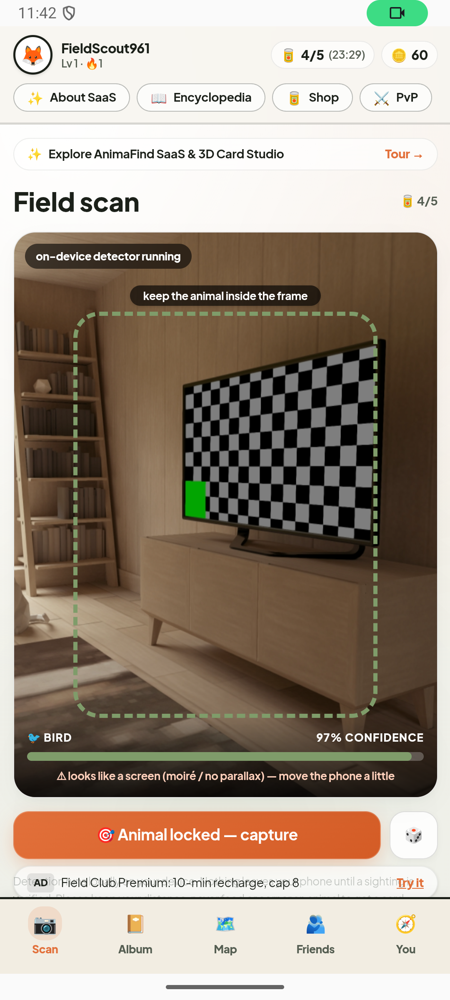 | 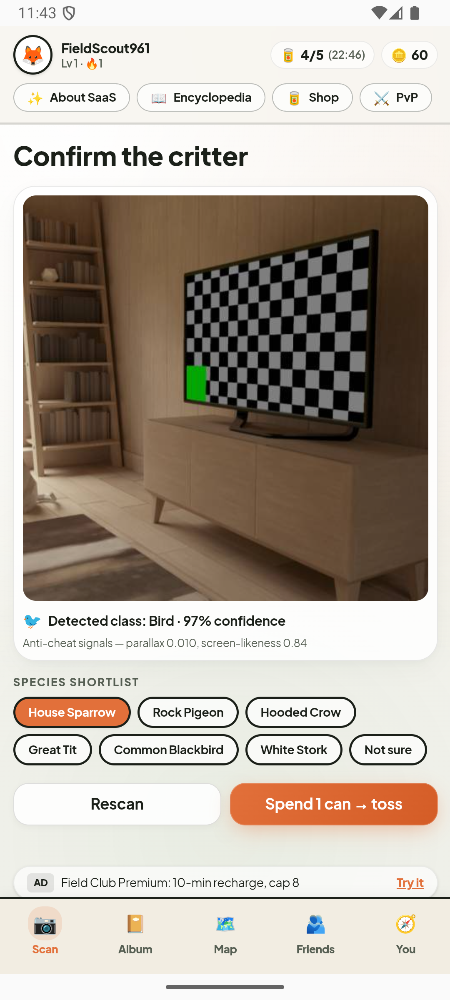 | 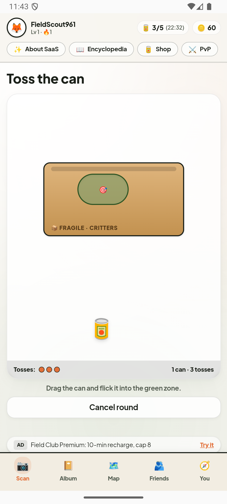 |

| 4. Field Journal / Album | 5. Community Discovery Map | 6. Field Crew / Friends |
| :---: | :---: | :---: |
| 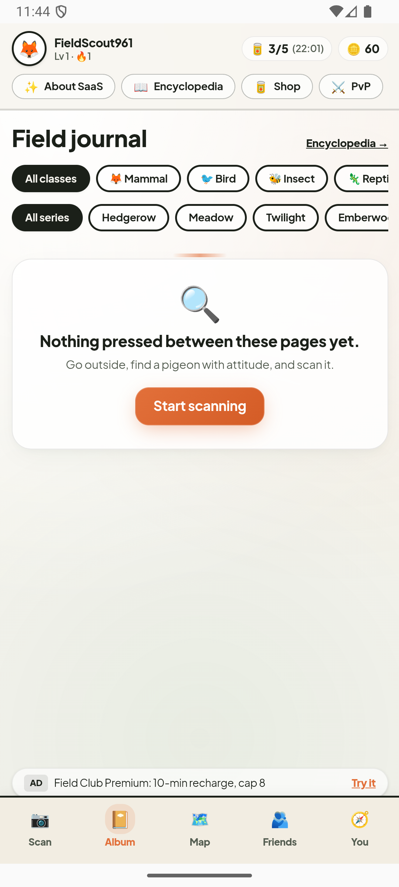 | 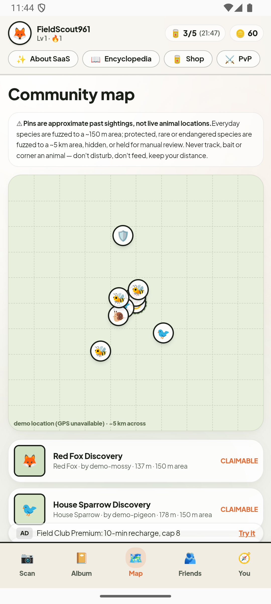 | 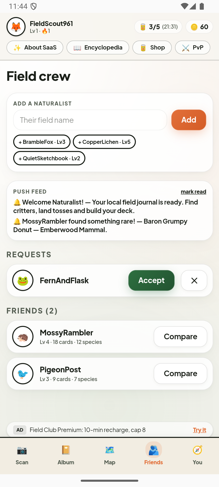 |

| 7. Naturalist Profile | 8. Supply Shop | 9. Critter Duels (PvP) |
| :---: | :---: | :---: |
| 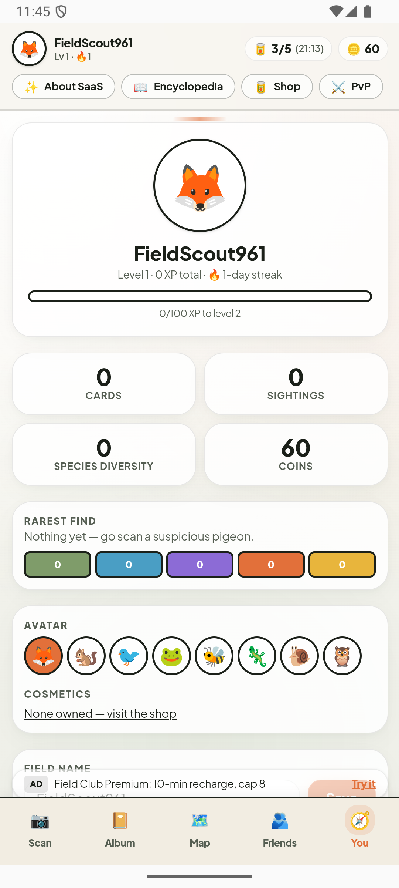 | 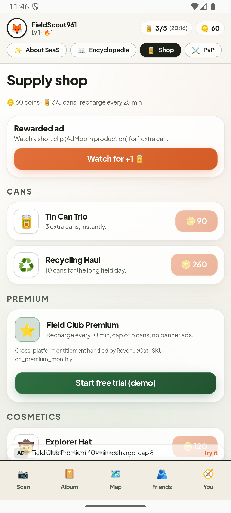 | 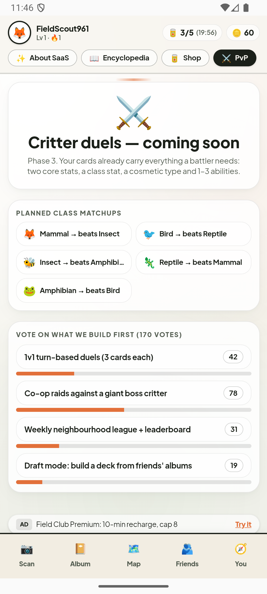 |

</div>

<details>
<summary><b>🔍 View Onboarding, Privacy & Permissions Flow</b></summary>
<br />

<div align="center">

| 1. Codex Introduction | 2. Privacy & Ethics | 3. GDPR Consent & Setup | 4. Runtime Permissions |
| :---: | :---: | :---: | :---: |
| 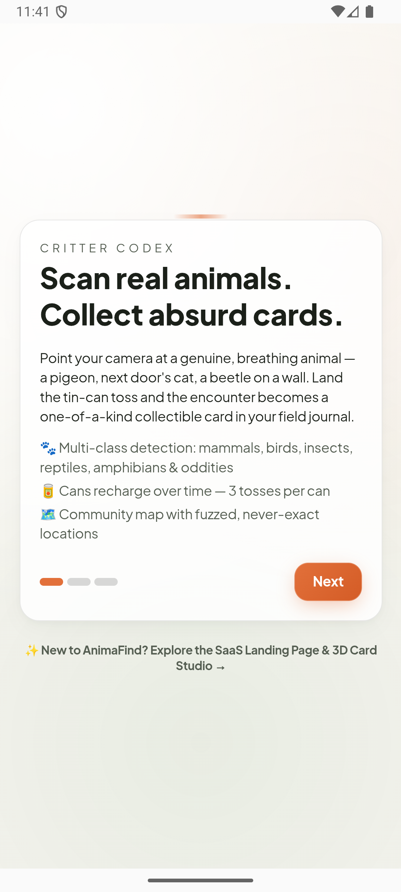 | 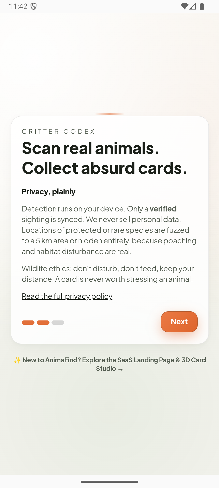 | 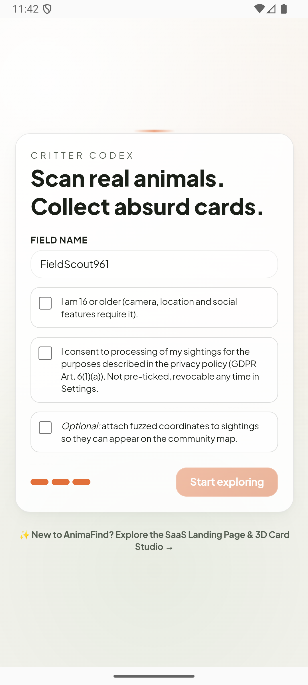 | 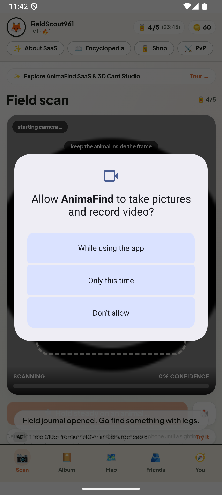 |

</div>

</details>

---

## 📖 Overview

**AnimaFind** gamifies nature appreciation and biodiversity exploration. Point your smartphone camera at living animals in your surroundings, pass on-device heuristic vision checks that detect physical depth while rejecting spoofed digital screens, land the intuitive tin-can toss minigame, and mint a procedurally generated collectible card with unique combat stats, abilities, serial numbers, and 5 rarity tiers!

```
  [1. Discover]      Locate a real animal (bird, mammal, insect, reptile, amphibian).
        ↓
  [2. Viewfinder]    Real-time on-device heuristics check confidence, parallax, & screen-glare.
        ↓
  [3. Capture]       Snap a photo and confirm the species shortlist.
        ↓
  [4. Toss Game]     Spend 1 tin can (energy) to flick the can into the drifting target zone.
        ↓
  [5. Mint Card]     Roll rarity tier (1–5), procedural stats, serial number, and abilities.
        ↓
  [6. Collect/Play]  Browse Album, Codex, Community Map, Friend Leaderboards, and Vote on PvP!
```

---

## ✨ Key Features

- **📱 On-Device Computer Vision & Anti-Cheat Pipeline**:
  - Center-weighted $32 \times 32$ luminance feature extraction directly on the client canvas.
  - Multi-class heuristic classification (`Mammal`, `Bird`, `Insect`, `Reptile`, `Amphibian`, `Other`).
  - **Parallax Motion Scoring**: Verifies true 3D scene depth and rejects flat static paper photos.
  - **Moiré Frequency Filtering**: Identifies high-frequency raster artifacts from monitors and phone screens.
  - **64-bit Perceptual Hashing (pHash)**: Rejects duplicate photo submissions.
  - Specimen simulator button (`🎲`) for testing and demonstration without a live camera.

- **🥫 Physics-Based Tin-Can Toss Minigame**:
  - Intuitive flick-and-toss mechanic with normalized delta-time parabolic physics.
  - Moving target zone and progressive feedback across 3 attempts per round.

- **🃏 Procedural Card Minting**:
  - **5 Rarity Tiers:** Hedgerow (Tier 1), Meadow (Tier 2), Twilight (Tier 3), Emberwood (Tier 4), and Aurora (Tier 5 Legendary with golden glow and animated sparkles).
  - Globally incremented serial numbers per rarity tier.
  - Combinatorial procedural names (Titles + Adjectives + Nouns).
  - Combat-ready stats (Snack, Charm, Grit/Speed/Swarm/Camouflage/Moisture) and procedural abilities.
  - Interactive 3D CSS card flipping with full collector details.

- **📖 Biodiversity Encyclopedia (Codex)**:
  - Tracks discovery progress across 35 curated European wildlife species.
  - Progress bars by taxonomic class with rarity ratings and leave-no-trace ethics badges.

- **🗺️ Fuzzed Community Discovery Map**:
  - Nearby sightings visualised on an SVG coordinate grid.
  - **Wildlife Protection Fuzzing**: Non-sensitive species fuzzed to ~150 m; sensitive species fuzzed to ~5 km or kept confidential to prevent poaching.
  - Proximity claiming: link cards when within 250 meters of community pins.

- **👥 Social Crew & PvP Roadmap**:
  - Compare deck diversity, highest rarity finds, and stats with friends.
  - Community roadmap voting on upcoming PvP combat systems.

- **🔋 Dual-Engine Offline Resilience**:
  - 100% playable offline in remote nature reserves without server connectivity using local IndexedDB storage.
  - Optional cloud backend powered by Drizzle ORM and PostgreSQL.

---

## 📸 Application Screenshots

<div align="center">

| Field Viewfinder | Card Reveal | Field Journal Album |
| :---: | :---: | :---: |
|  |  |  |

| Community Map | 3D Card Studio | Wildlife Codex |
| :---: | :---: | :---: |
|  |  |  |

</div>

---

## 🛠️ Technology Stack

| Layer | Technologies | Details |
| :--- | :--- | :--- |
| **Frontend Framework** | Next.js 16 (App Router, Turbopack) & React 19 | Responsive mobile-first UI with static generation (`output: export`) |
| **Mobile Runtime** | Capacitor 8 (`@capacitor/core`, `@capacitor/android`, `@capacitor/ios`) | Native hardware acceleration, WKWebView & Android WebView bridges |
| **Styling System** | TailwindCSS v4 + Glassmorphism Theme | Frosted glass cards, Plus Jakarta Sans, paper/ink palette |
| **Language** | TypeScript 5.9 | Strict typechecking enabled |
| **Testing** | Node.js Test Runner + `tsx` | Unit and integration test suites for math, geo, vision, storage |
| **Local Storage** | IndexedDB (`animafind_db`) + LocalStorage Fallback | On-device persistent database with storage quota safeguards |
| **Cloud Database (Optional)**| PostgreSQL + Drizzle ORM | Optional relational cloud sync and community leaderboard backend |
| **Android Build** | Gradle 8.13, Android SDK 36, Java JDK 21 | R8 / ProGuard obfuscation rules & release signing support |
| **iOS Build** | Xcode 15+, iOS 15+ target, Swift 5.9 | Swift Package Manager plugin integration |

---

## ⚡ Prerequisites

Before running or building AnimaFind, ensure your development machine has:
- **Node.js**: `>= 20.0.0` (LTS v22 or v24 recommended)
- **npm**: `>= 10.0.0`
- **Java JDK**: `21 LTS` (Required for Android builds)
- **Android Studio**: Ladybug / Otter or newer with Android SDK API 36 (for Android)
- **Xcode**: `15.0+` on macOS (for iOS builds)

---

## 🚀 Quickstart & Local Development

### 1. Clone & Install
```bash
git clone https://github.com/your-username/AnimaFind.git
cd AnimaFind
npm install
```

### 2. Environment Setup
```bash
cp .env.example .env
```

### 3. Start Development Server
```bash
npm run dev
```
Open [http://localhost:3000](http://localhost:3000) to test the application in your browser.

---

## 🧪 Running Automated Tests

AnimaFind includes a test suite covering game mathematics, vision heuristics, geospatial distance calculation, and offline persistence:

```bash
# Run all unit and integration tests
npm test

# Run TypeScript type validation
npm run typecheck

# Run ESLint code style analysis
npm run lint
```

---

## 📱 Mobile Builds (Android & iOS)

### Building the Static Web Assets for Mobile
```bash
npm run build:mobile
```
This compiles the Next.js static bundle into `./out` and synchronizes native assets into `./android` and `./ios`.

### Android Build Commands
```bash
# Build Debug APK (Local Testing)
npm run android:debug

# Build Release APK (Production)
npm run android:release

# Open project in Android Studio
npm run cap:android
```
Built APK files are located at:
- `android/app/build/outputs/apk/debug/app-debug.apk`
- `android/app/build/outputs/apk/release/app-release-unsigned.apk` (or signed `app-release.apk`)

### iOS Build Commands (macOS)
```bash
# Open project in Xcode
npm run cap:ios
```
From Xcode, select your simulator or physical device and press `Cmd + R` to run.

---

## 🏛️ Architecture

For complete system design diagrams, dual-engine data flow, and anti-cheat algorithms, read our [Architecture Guide](./docs/ARCHITECTURE.md).

---

## 📚 Documentation Links

- 🚀 [Installation Tutorial (`docs/INSTALLATION.md`)](./docs/INSTALLATION.md) — Step-by-step setup, verification commands, and native build tutorial.
- 📖 [Feature & Usage Guide (`docs/USAGE.md`)](./docs/USAGE.md) — Complete user guide for the viewfinder, toss minigame, album, codex, and map.
- 🔧 [Troubleshooting Guide (`docs/TROUBLESHOOTING.md`)](./docs/TROUBLESHOOTING.md) — Solutions for camera permissions, Gradle JVM, and build errors.
- 🛠️ [Environment Setup Guide (`docs/SETUP.md`)](./docs/SETUP.md) — Tooling specifications for Android Studio, JDK 21, and Xcode.
- 🏛️ [System Architecture (`docs/ARCHITECTURE.md`)](./docs/ARCHITECTURE.md) — Deep dive into the dual-engine architecture, vision pipeline, and security model.
- 📦 [Build & Release Guide (`docs/BUILD_AND_RELEASE.md`)](./docs/BUILD_AND_RELEASE.md) — Android keystore setup, iOS signing, and CI/CD operations.
- 🤝 [Contributing Guidelines (`CONTRIBUTING.md`)](./CONTRIBUTING.md) — Coding conventions, branching strategy, and pull request checklist.
- 📜 [Code of Conduct (`CODE_OF_CONDUCT.md`)](./CODE_OF_CONDUCT.md) — Community standards and harassment policy.
- 📋 [Changelog (`CHANGELOG.md`)](./CHANGELOG.md) — Chronological record of defects fixed, features added, and security enhancements.

---

## 📄 License

This project is licensed under the terms of the [MIT License](./LICENSE).
