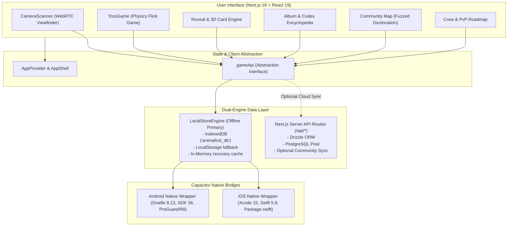

# 🏛️ AnimaFind Technical Architecture & Dual-Engine Specification

## 1. System Architecture Overview

AnimaFind ("Critter Codex") is engineered as a cross-platform mobile application combining a high-performance modern web application core with native platform runtimes via Capacitor 8.



---

## 2. Dual-Engine Storage Architecture

To provide an uninterrupted, zero-latency outdoor experience for hikers and naturalists in remote nature reserves with zero cell connectivity, AnimaFind operates on a **Local-First Dual Engine**:

### 1. Offline Local Engine (`src/lib/local-store.ts`)
- **Default for Mobile:** Active on native Android, iOS, and offline web browsers.
- **Persistence:** Primary storage in IndexedDB database `animafind_db` (store: `saves`), mirrored synchronously to `localStorage` key `animafind_local_save_v1`.
- **Quota Safeguard:** Automatically detects storage quota limitations, intelligently pruning redundant duplicate image buffers in historical records while maintaining thumbnails, card data, and combat stats intact.
- **Self-Contained Logic:** Calculates energy (can) regeneration, rolls procedural cards, simulates community pins, records friends, and tallies local votes without needing an external server.

### 2. Optional Cloud Backend (`src/db/` & `src/app/api/`)
- Powered by **Drizzle ORM** and **PostgreSQL**.
- Handles server-authoritative multiplayer sync, account exports, global map pins, and verified community leaderboard aggregations.

---

## 3. Directory & Module Structure

```
AnimaFind/
├── .github/
│   ├── ISSUE_TEMPLATE/            # GitHub issue forms (Bug report, Feature request)
│   ├── PULL_REQUEST_TEMPLATE.md   # Standard pull request verification checklist
│   └── workflows/                 # CI/CD Automation
│       ├── android-build.yml      # Continuous integration & Android release APK build
│       ├── ios-build.yml          # iOS simulator & archive verification
│       └── release.yml            # Semantic tag release packaging & publishing
├── android/                       # Native Android Studio Project
│   ├── app/                       # Android application module
│   │   ├── build.gradle           # SDK 36, signing configuration, ProGuard
│   │   ├── proguard-rules.pro     # Production R8 obfuscation rules
│   │   └── src/main/              # AndroidManifest.xml, icons, native Java bridge
│   ├── gradle/wrapper/            # Gradle 8.13 wrapper
│   └── variables.gradle           # SDK version declarations
├── docs/                          # Comprehensive Documentation
│   ├── ARCHITECTURE.md            # System design & architecture (this file)
│   ├── BUILD_AND_RELEASE.md       # Platform release & signing guide
│   └── SETUP.md                   # Local development setup instructions
├── ios/                           # Native Xcode iOS Project
│   └── App/                       # Swift app delegate, Info.plist, Package.swift
├── public/                        # Static assets, manifests, icons
├── scripts/
│   └── build-mobile.cjs           # Next.js static export & Capacitor synchronization
├── src/
│   ├── app/                       # Next.js 16 App Router pages
│   │   ├── album/                 # Field journal collection deck with search & filters
│   │   ├── api/                   # Optional cloud backend endpoints
│   │   ├── card/                  # Deep-linked card detail views & removal
│   │   ├── codex/                 # 35-species European wildlife encyclopedia
│   │   ├── friends/               # Field crew social compare & requests
│   │   ├── landing/               # Product showcase & 3D card studio tour
│   │   ├── map/                   # Fuzzed community discovery map
│   │   ├── profile/               # Naturalist stats, streaks, avatars & cosmetics
│   │   ├── pvp/                   # Critter duel roadmap & voting polls
│   │   ├── settings/              # GDPR consents, location toggles & export
│   │   ├── shop/                  # In-game supplies & Field Club subscription
│   │   ├── layout.tsx             # Root layout, fonts, ErrorBoundary & AppShell
│   │   └── page.tsx               # Primary camera viewfinder & encounter loop
│   ├── components/                # Modular React 19 components
│   │   ├── scan/                  # CameraScanner, TossGame, Reveal modals
│   │   ├── AppProvider.tsx        # Context state, cans refresh, toast notifications
│   │   ├── AppShell.tsx           # Responsive mobile frame, safe area padding, tabs
│   │   ├── CardDetailView.tsx     # Full card inspector with confirmation dialogs
│   │   ├── CardViews.tsx          # CardTile and 3D interactive flip cards
│   │   └── Onboarding.tsx         # 3-step GDPR naturalist onboarding flow
│   ├── db/                        # Database configuration and Drizzle schema
│   └── lib/                       # Pure business logic & game engines
│       ├── api-client.ts          # Unified client interface abstraction
│       ├── audio.ts               # Synthesized Web Audio API sound effects
│       ├── card-gen.ts            # Procedural name, rarity, stat & ability generator
│       ├── economy.ts             # Energy caps and recharge algorithms
│       ├── game-data.ts           # Taxonomic classes, 35 species metadata & constants
│       ├── geo.ts                 # Haversine distance and coordinate fuzzing
│       ├── local-store.ts         # Local-first persistence engine
│       ├── store-catalog.ts       # Store inventory and cosmetic definitions
│       ├── types.ts               # Shared TypeScript domain contracts
│       └── vision.ts              # 32x32 feature extraction, moiré & pHash
└── tests/                         # Automated unit & integration tests
    ├── card-gen.test.ts           # Math, rarity, and ability generator tests
    ├── economy.test.ts            # Energy caps and store catalog tests
    ├── geo.test.ts                # Geodesic distances and fuzzing tests
    ├── local-store.test.ts        # Storage lifecycle, rounds, deck & social tests
    └── vision.test.ts             # Feature extraction and anti-cheat tests
```

---

## 4. Computer Vision & Anti-Cheat Heuristics

The camera processing pipeline operates on-device inside the HTML5 canvas without streaming raw frames to remote servers:

1. **Downsampling & Grid Partitioning:** The center view area is downsampled to a $32 \times 32$ luminance grid (1,024 sample cells).
2. **Feature Extraction:** Measures overall luminance mean, high-frequency spatial variation (edges), color temperature (warmth), foliage bias (greenness), and channel saturation.
3. **Parallax Motion Scoring:** Compares consecutive frame luminance deltas against previous frame buffers. Stationary flat paper photos fail the minimum parallax motion threshold.
4. **Moiré Frequency Filtering:** Digital computer monitors and mobile phone screens emit characteristic high-frequency grid interference patterns (raster frequency spikes). The moiré scorer detects these patterns and downgrades spoofed submissions.
5. **64-bit Perceptual Hash (`pHash`):** Compares bit difference against an internal cache of previously submitted captures using Hamming distance to block duplicate photo uploads.

---

## 5. Security & Wildlife Protection Policies

- **Anti-Poaching Coordinate Fuzzing:** Exact coordinates of wildlife sightings are never exposed publicly. Non-sensitive species receive a randomized ~150 m offset. Protected, rare, or endangered species are fuzzed to a ~5 km area or withheld entirely from public map displays.
- **Client-Side Data Ownership:** Users can export their complete field journal (`exportAccount`) or purge their entire account (`deleteAccount`) in compliance with GDPR Art. 17 & 20.
- **Hardened Release Signing:** Keystore passwords and private signing keys are decoupled from the code and supplied strictly through environment variables or GitHub Secrets.
